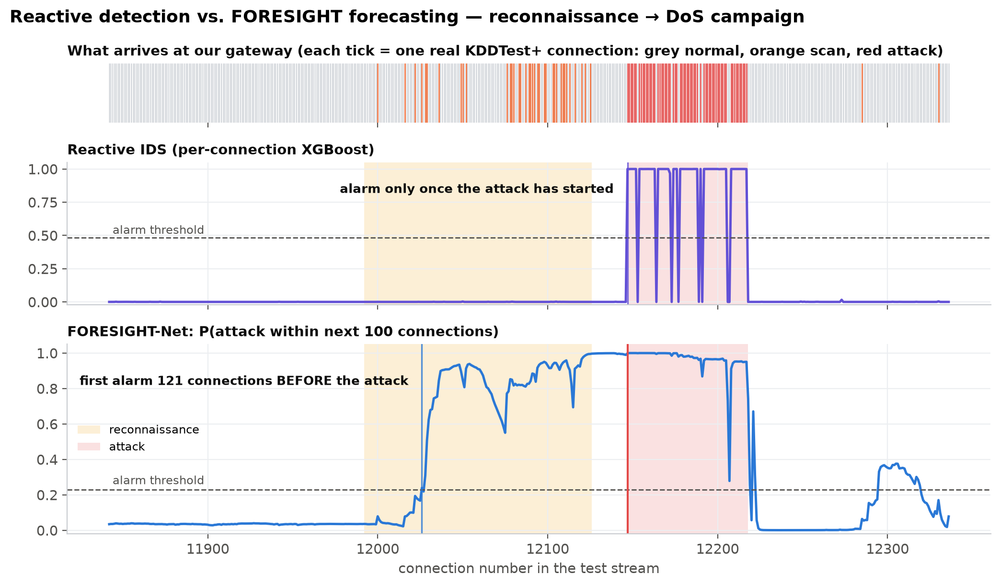
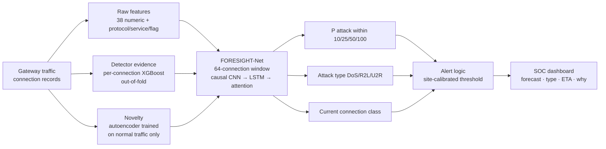
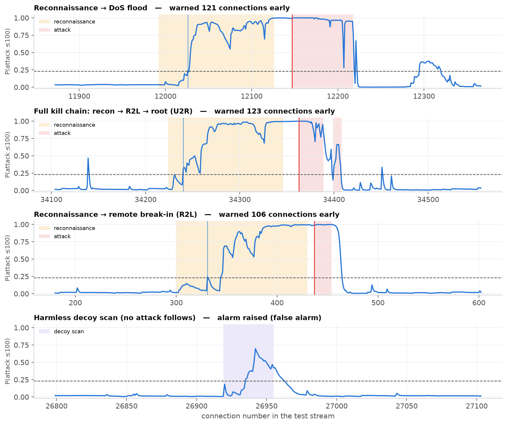
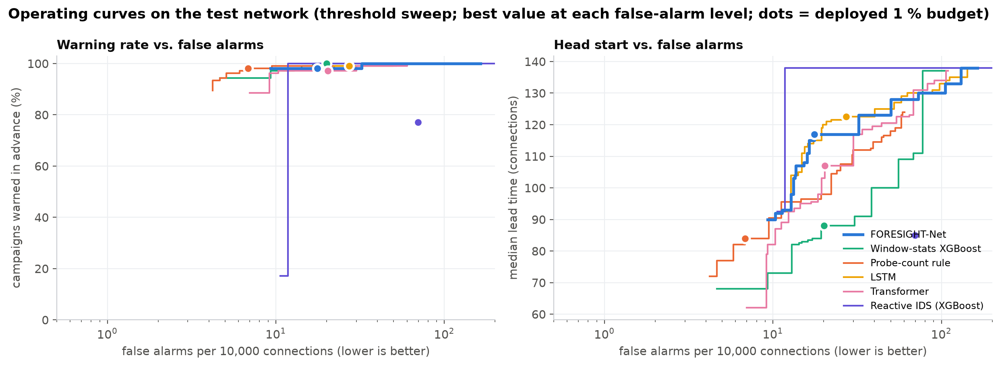
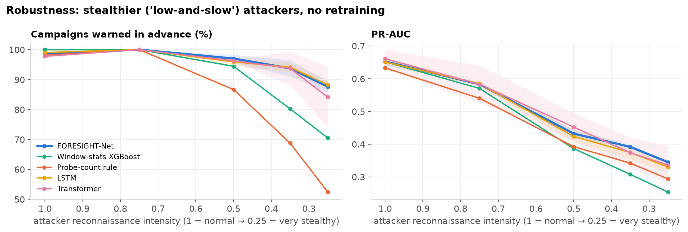
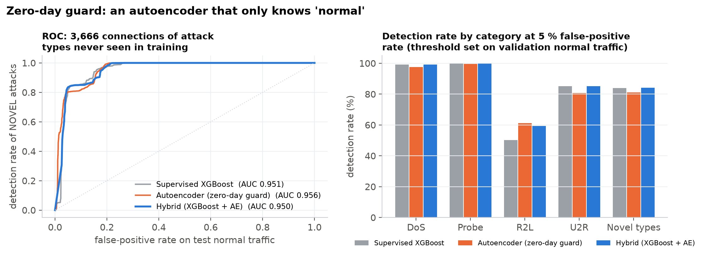
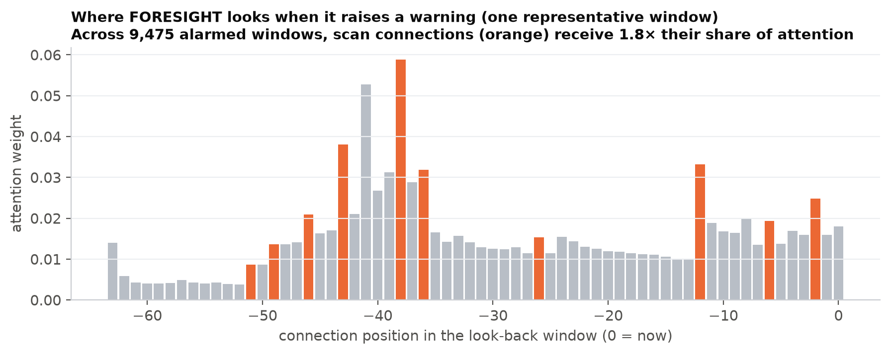
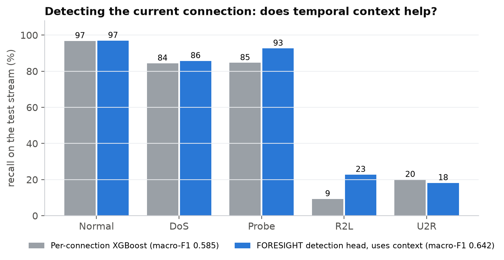
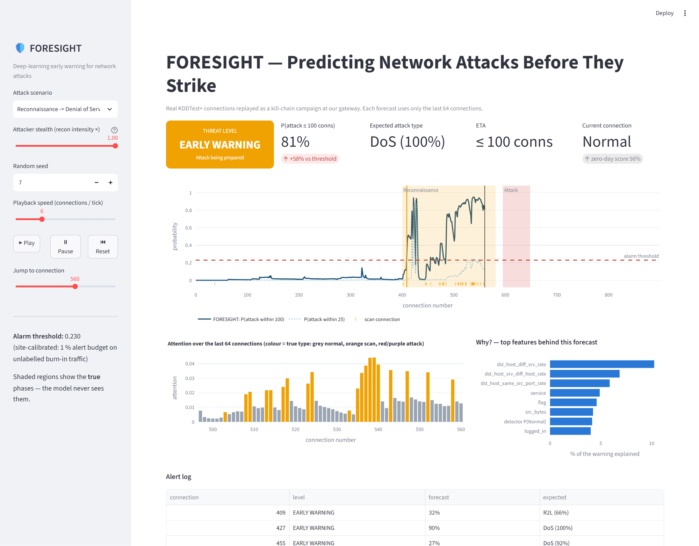

# FORESIGHT — Predicting Network Attacks Before They Strike

**A deep-learning early-warning intrusion detection system.** FORESIGHT watches
the stream of connections at our own network gateway — the defender's viewpoint —
recognises the *reconnaissance* that precedes an attack, and forecasts **whether**,
**when** (within 10 / 25 / 50 / 100 connections) and **which** attack (DoS, R2L,
U2R) is coming. It explains every warning, catches never-seen attacks with a
zero-day guard, and adapts to a new network without needing attack labels.

> Major Project-I (18B19CI791), AY 2026-27 — Jaypee University of Information Technology
> Team: Nikhil Singh (231030152) · Rudra Bhasin (231030235) · Raghav Dhir (231030254) · Aayush Chaudhary (231030164)
> Supervisor: Prof. Dr. Pardeep Kumar, Dept. of CSE & IT



*A real test-network campaign. Top: every tick is one real KDDTest+ connection
(grey normal, orange scans, red attack). Middle: a classical per-connection IDS
fires only once the attack has arrived. Bottom: FORESIGHT's forecast crosses the
alarm threshold during the reconnaissance — well before the attack.*

---

## Contents

1. [The idea](#1-the-idea)
2. [What is in this repository](#2-what-is-in-this-repository)
3. [Quick start](#3-quick-start)
4. [How it works](#4-how-it-works)
5. [Results](#5-results)
6. [Project structure](#6-project-structure)
7. [Limitations](#7-limitations)
8. [References](#8-references)

---

## 1. The idea

A classical IDS is a **smoke alarm**: it judges each connection on its own and
rings when the attack traffic is already inside. FORESIGHT is closer to a
**weather forecast**.

Real intrusions are multi-stage (Lockheed-Martin Cyber Kill Chain; MITRE ATT&CK
TA0043 *Reconnaissance*): before an attacker floods a server or breaks in, they
discover live hosts, enumerate ports and scan for vulnerabilities. Those scans
cross our own gateway. FORESIGHT reads the last 64 connections as a sequence and
asks: *is this the beginning of an attack, and how soon will it land?*

The hard part is that scanning is everywhere and mostly harmless, and that every
network has its own "normal". FORESIGHT is trained on one network (KDDTrain+) and
evaluated on another (KDDTest+) that contains **17 attack types never seen in
training**.

## 2. What is in this repository

| Phase | What | Where |
|---|---|---|
| **Phase 1** (mid-term) | Classical ML, per-connection detection on NSL-KDD: 6 classifiers, SMOTE + cost-sensitive XGBoost, honest official-split evaluation (~79 % accuracy, R2L recall 0.12) | `src/`, `results/`, `PROGRESS_REPORT.md` |
| **Phase 2** (this work) | **FORESIGHT**: attack forecasting with deep sequence models, zero-day guard, site adaptation, explanations, live dashboard | `foresight/`, `app/`, `run_pipeline.py`, `monitor.py`, `outputs/` |
| Documentation | Methodology (every design decision), panel guide (talk track + 35 Q&A) | `docs/` |
| Presentation | 31-slide deck with speaker notes, generated from the results | `presentation/` |

## 3. Quick start

```bash
# Python 3.11; install the CUDA build of PyTorch from pytorch.org if you have an NVIDIA GPU
pip install -r requirements.txt

# 1. Reproduce every experiment, table and figure (~1 h on an RTX 4060 laptop, plugged in)
python run_pipeline.py
#    quick 3-minute smoke test (tiny streams, 1 seed) -> outputs_quick/
python run_pipeline.py --quick
#    single stages:  data baselines deep ablation robust zeroday explain latency summary figures
python run_pipeline.py --stage figures

# 2. Live SOC dashboard (opens in the browser)
streamlit run app/dashboard.py
#    open directly on a warning:  http://localhost:8501/?scenario=recon_dos&t=520

# 3. Terminal live monitor (backup demo)
python monitor.py --scenario recon_dos
python monitor.py --scenario decoy_scan
python monitor.py --scenario recon_r2l_u2r --stealth 0.5

# 4. Rebuild the presentation from the latest results
python presentation/make_deck_data.py
cd presentation && npm install && node build_deck.js
```

The NSL-KDD files `data/KDDTrain+.txt` and `data/KDDTest+.txt` are included.
Finished training runs are cached in `outputs/results/runs/`, so an interrupted
pipeline simply resumes.

## 4. How it works



**Data and simulator** (`foresight/data.py`, `foresight/simulator.py`). NSL-KDD
records are real connections but shuffled, with no timestamps. FORESIGHT replays
real records in the order a kill-chain campaign would produce them: normal
traffic (with realistic bursts) → reconnaissance in three stages (discovery,
port scan, vulnerability scan) whose intensity escalates from 3–8 % to 30–60 % →
pause → DoS / R2L / U2R attack. 28 % of campaigns are **decoy scans** with nothing
after them, 12 % of attacks have **no warning at all**, and stray scans appear
in normal traffic. The test stream uses only KDDTest+ records.

**FORESIGHT-Net** (`foresight/models.py`). Connection encoder (learned
embeddings) → 3 causal dilated convolution blocks (short bursts) → 2-layer LSTM
(slow escalation) → additive temporal attention (focus and explanation) → three
heads: a **survival-style early-warning head** (per-interval hazards, so
P(attack ≤ h) is monotone in h and yields an ETA), an attack-type head and a
detection head, trained jointly.

**Generalisation to a new network** (`foresight/train.py`, `foresight/metrics.py`).
Three ingredients made the model work on an unseen network: (1) *evidence
channels* — out-of-fold detector probabilities and autoencoder novelty — instead
of raw features alone; (2) robustness training (token, feature and **modality
dropout**); (3) **site adaptation**: on the new network the model observes
unlabelled, attack-free traffic, fine-tunes briefly to learn its "normal", and
sets its alarm threshold for a 1 % alert budget. No attack labels from the new
network are used.

Full details, including what did **not** work: [`docs/METHODOLOGY.md`](docs/METHODOLOGY.md).

## 5. Results

<!-- RESULTS:START -->
All numbers on the **test network** (160 campaigns built only from KDDTest+
records, 17 unseen attack types). Every method gets the **same alert budget**
on the new network (alarm on at most 1 % of unlabelled burn-in windows); deep
models are site-adapted, share identical inputs, heads and training, and are
reported as the mean of 3 seeds. Full tables: [`outputs/results/RESULTS.md`](outputs/results/RESULTS.md).

| Method | PR-AUC | Campaigns warned in advance | Median lead (connections) | False alarms / 10k | Alert precision |
|---|---:|---:|---:|---:|---:|
| Reactive IDS (per-connection XGBoost, Phase-1 style) | 0.167 | 77 %* | 85* | 69.8 | 34 % |
| Probe-count rule (SOC correlation rule) | 0.633 | 98 % | 84 | **6.8** | **70 %** |
| Window-statistics XGBoost | 0.652 | 100 % | 88 | 20.1 | 54 % |
| MLP | 0.662 | 98 % | **121** | 28.0 | 46 % |
| 1D-CNN | **0.687** | 100 % | 117 | 28.9 | 48 % |
| LSTM | 0.651 | 99 % | 120 | 24.9 | 48 % |
| GRU | 0.655 | 99 % | 113 | 42.8 | 38 % |
| Transformer | 0.661 | 98 % | 108 | 21.8 | 56 % |
| **FORESIGHT-Net** | 0.653 ± 0.008 | 99 % | 120 | 19.6 | 56.5 % |

\* the reactive IDS's "early" alarms are false positives on scan traffic (alert precision 34 %).

**What the results show**

* **Earlier warnings at the same cost.** At the same false-alarm level as the
  strongest classical model (window-statistics XGBoost, ≈20 per 10k), FORESIGHT-Net
  warns **36 % earlier** (median 120 vs 88 connections) with slightly higher alert
  precision. Against the very conservative scan-count rule it warns 43 % earlier
  but raises about 3× as many false alarms — the operating curves
  (`fig05_operating_curve.png`) show the full trade-off.
* **Graceful under stealth.** With attackers scanning at a quarter of the normal
  intensity (no retraining), FORESIGHT-Net still warns for **88 %** of campaigns,
  104 connections early; the scan-count rule drops to 52 % and window XGBoost to 70 %.
* **Site adaptation is decisive.** Zero-shot on the new network: 66 false alarms
  per 10k. Calibrating the threshold only: 12 per 10k but a median lead of just 40.
  Adapted + calibrated: 120 connections of lead at 19.6 false alarms per 10k.
* **Which attack and when.** Attack type forecast correctly 70 % of the time before
  impact (macro-F1 0.69, best of the deep models); ETA within one horizon bin 87 %.
* **Context helps detection.** The context-aware detection head raises R2L recall
  from 9 % (per-connection XGBoost) to 23 % — Phase 1's main weakness (upper bound:
  part of the gain comes from the simulated campaign structure).
* **Ablation.** Removing any FORESIGHT-Net component lowers alert precision
  (56.5 % → 43–53 %) and raises false alarms (19.6 → 22–33 per 10k); PR-AUC changes
  are small (largest: without multi-task, 0.653 → 0.635).
* **Zero-day guard.** On 3,666 connections of never-seen attack types the
  autoencoder has the best AUC (0.956); at a 5 % validation false-positive rate the
  hybrid detects 84 % of them and the autoencoder catches more R2L (61 % vs 50 %).
* **Explainable.** In alarmed reconnaissance windows, scan connections receive
  **1.8×** their share of attention.
* **Real-time.** 349,653 parameters, ~74 s training per model on an RTX 4060 laptop
  GPU, **2.7 ms per forecast on a CPU**, ~50,000 forecasts/s batched on GPU.
* **Honest weak spots.** 86 % of harmless decoy scans still trigger a warning, and
  attacks without reconnaissance cannot be forecast (their 39 % "warned" equals
  the chance of a false alarm in the 200 connections before them).

| | |
|---|---|
|  |  |
|  |  |
|  |  |


<!-- RESULTS:END -->

## 6. Project structure

```
major project/
├── run_pipeline.py          one command: every experiment, table and figure
├── monitor.py               terminal live demo
├── requirements.txt
├── foresight/               the FORESIGHT package (every module documented)
│   ├── config.py            all hyper-parameters in one place
│   ├── data.py              NSL-KDD loading, disjoint pools, feature encoder
│   ├── simulator.py         kill-chain campaign stream simulator + labels
│   ├── windows.py           GPU sliding-window batches, evidence features
│   ├── models.py            FORESIGHT-Net + MLP/CNN/LSTM/GRU/Transformer, survival loss
│   ├── train.py             training, augmentation, site adaptation, checkpoints
│   ├── baselines.py         reactive IDS, scan-count rule, window-stats XGBoost, OOF stacking
│   ├── zero_day.py          autoencoder zero-day guard
│   ├── metrics.py           step- and event-level metrics, site threshold
│   ├── explain.py           attention focus, gradient × input attribution
│   ├── experiments.py       pipeline stages, caching, result tables
│   ├── figures.py           the 15 figures
│   └── inference.py         deployed-system API (dashboard, monitor)
├── app/dashboard.py         Streamlit SOC dashboard
├── docs/
│   ├── METHODOLOGY.md       complete technical description
│   └── PANEL_GUIDE.md       how to present + 35 expected questions with answers
├── presentation/
│   ├── FORESIGHT_Major_Project_Presentation.pptx   (speaker notes on every slide)
│   ├── make_deck_data.py    numbers for the slides, read from outputs/
│   └── build_deck.js        slide builder (pptxgenjs)
├── outputs/                 generated: models/, results/ (RESULTS.md, CSV, JSON), figures/
├── data/                    NSL-KDD (KDDTrain+, KDDTest+)
├── src/, results/           Phase 1 (classical ML, mid-term)
└── PROGRESS_REPORT.md       Phase 1 report
```

## 7. Limitations

* **Simulated temporal order.** Connections are real; the campaign order follows a
  kill-chain model because NSL-KDD has no timestamps. Real timestamped traffic
  (CIC-IDS2017, UNSW-NB15) is the next step — only the stream source changes.
* **Attacks without reconnaissance cannot be forecast** by any method; they are
  detected on arrival.
* **Decoy scans** genuinely resemble the start of an attack; early warning costs
  some false alarms (see the operating curves).
* **Strong simple baselines.** A scan-count rule is conservative and competitive,
  and the deep backbones are close to each other once they share FORESIGHT's
  evidence channels and site adaptation — all reported, not hidden.
* **Test-informed design iterations** are disclosed in METHODOLOGY §8.

## 8. References

1. M. Tavallaee et al., "A detailed analysis of the KDD CUP 99 data set," IEEE CISDA, 2009.
2. Z. Ahmad et al., "Network intrusion detection system: A systematic study of machine learning and deep learning approaches," *Trans. Emerging Telecommunications Technologies*, 2021.
3. M. Husák et al., "Survey of attack projection, prediction, and forecasting in cyber security," *IEEE Communications Surveys & Tutorials*, 21(1), 2019.
4. Y. Shen et al., "Tiresias: Predicting security events through deep learning," ACM CCS, 2018.
5. M. Du et al., "DeepLog: Anomaly detection and diagnosis from system logs through deep learning," ACM CCS, 2017.
6. Y. Mirsky et al., "Kitsune: An ensemble of autoencoders for online network intrusion detection," NDSS, 2018.
7. E. M. Hutchins, M. J. Cloppert, R. M. Amin, "Intelligence-driven computer network defense informed by analysis of adversary campaigns and intrusion kill chains," Lockheed Martin, 2011; MITRE ATT&CK TA0043 / T1595.
8. W. E. Leland et al., "On the self-similar nature of Ethernet traffic," *IEEE/ACM Trans. Networking*, 1994.
9. S. Hochreiter, J. Schmidhuber, "Long short-term memory," *Neural Computation*, 1997; D. Bahdanau et al., "Neural machine translation by jointly learning to align and translate," ICLR, 2015.
10. T. Chen, C. Guestrin, "XGBoost: A scalable tree boosting system," KDD, 2016; D. H. Wolpert, "Stacked generalization," *Neural Networks*, 1992.
